# Requirements Management App

A web-based application for software requirements specification
and analysis, developed as an academic team project for the
Software Engineering course at the University of Ioannina.

The application provides a collaborative environment for managing
software projects, defining requirements through Use Cases and
CRC Cards, and generating UML diagram scripts.

## Features

- User registration and authentication
- User profile management
- Project creation and management
- Use Case creation, editing and deletion
- CRC Card creation, editing and deletion
- Linking Use Cases with CRC Cards
- UML script generation for PlantUML and Nomnoml
- Project sharing and team collaboration
- Comments on Use Cases and CRC Cards
- Comment editing and deletion
- Comment ownership and access control

## Technologies

### Backend

- Java 17
- Spring Boot 4.0.3
- Spring MVC
- Spring Security
- Spring Data JPA

### Frontend

- HTML
- CSS
- Thymeleaf

### Database

- MySQL

### Build and Testing Tools

- Maven
- JUnit Jupiter
- Mockito

### Development Environment

- Eclipse IDE

### Modeling Tools

- UML
- PlantUML
- Nomnoml

## Application Screenshots

The following screenshots demonstrate the main functionalities
of the application using an example project named
**Online Bookstore System**.

### User Authentication

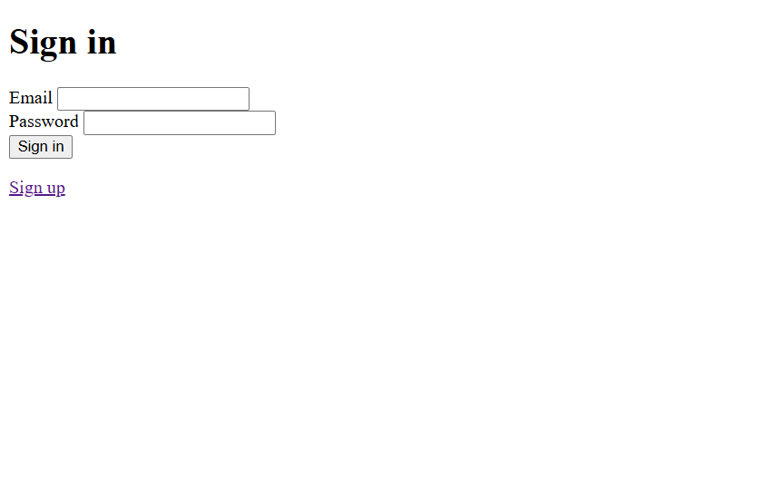

### Project Management

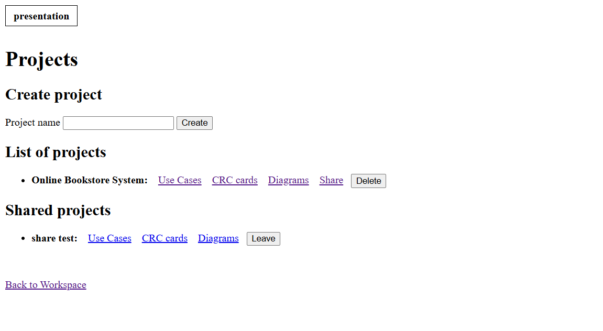

### Use Case Management

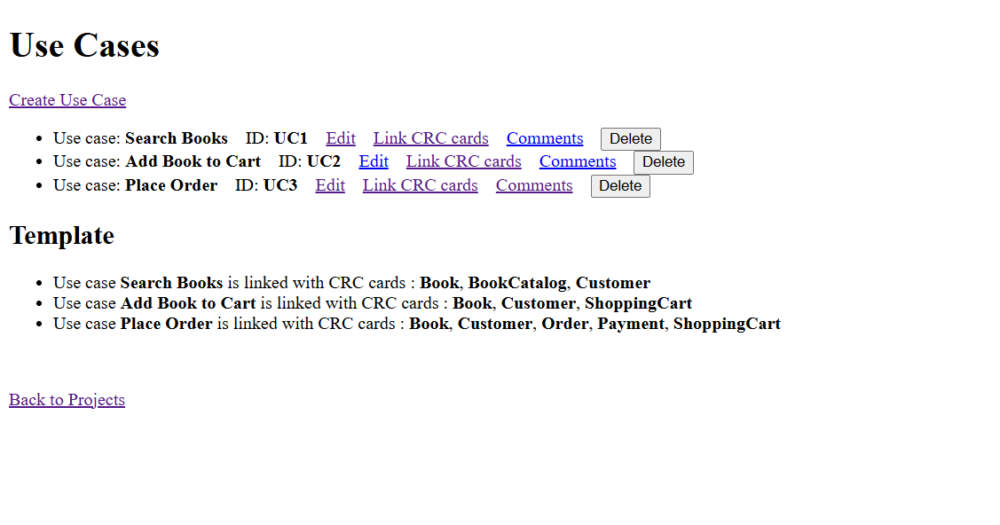

### CRC Card Management

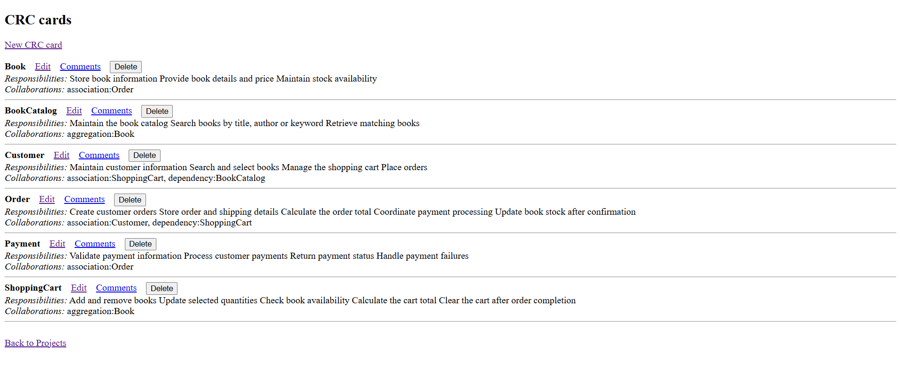

### Linking Use Cases with CRC Cards

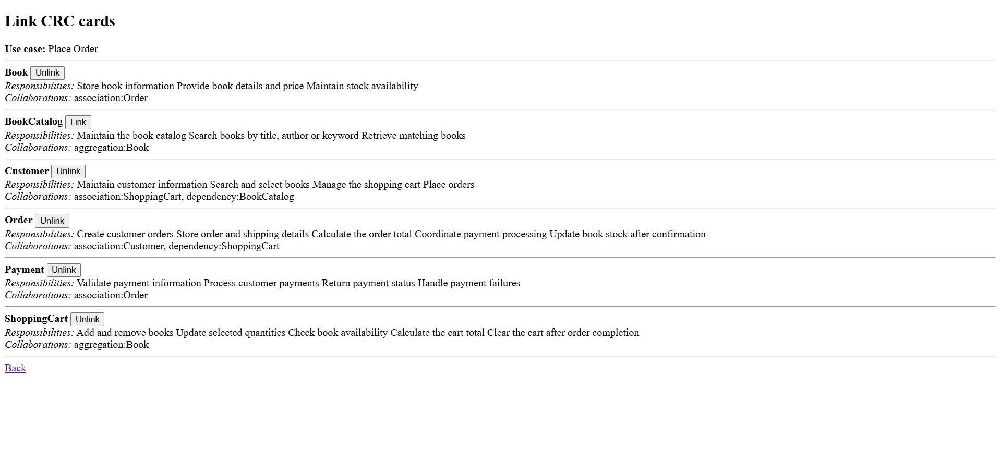

### Project Sharing

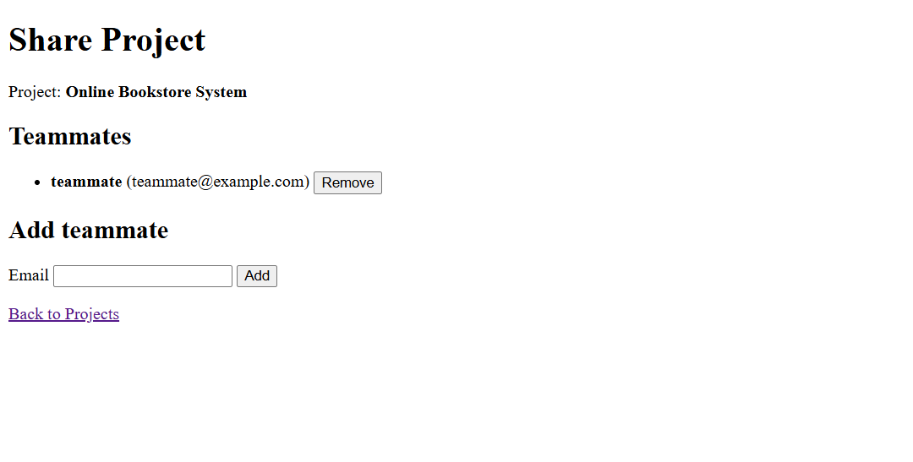

### Comments and Collaboration

Users can add comments to Use Cases and CRC Cards.
Each user can edit or delete only their own comments.

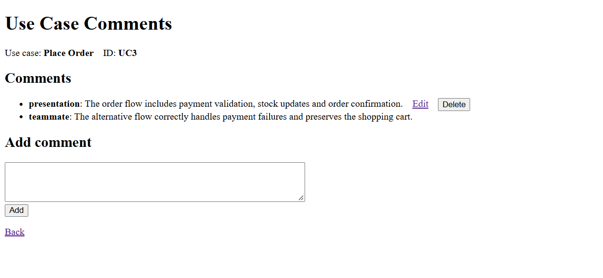

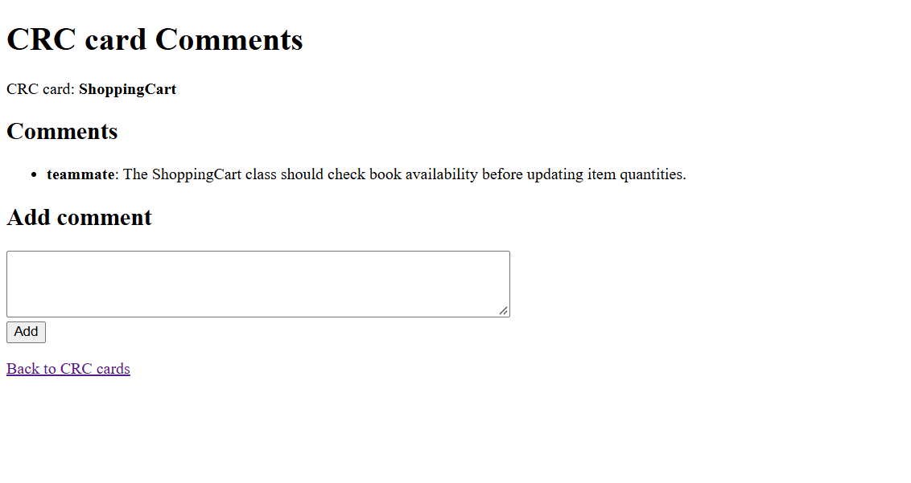

### Comment Editing

Users can modify the content of their existing comments.

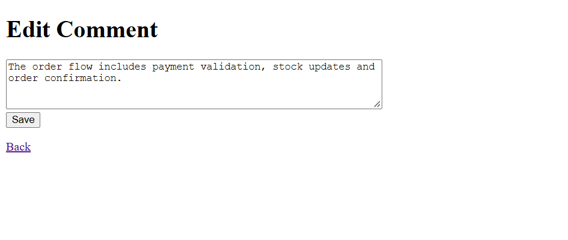

### UML Script Generation

The application generates textual diagram scripts for
PlantUML and Nomnoml based on the project's Use Cases
and CRC Cards.

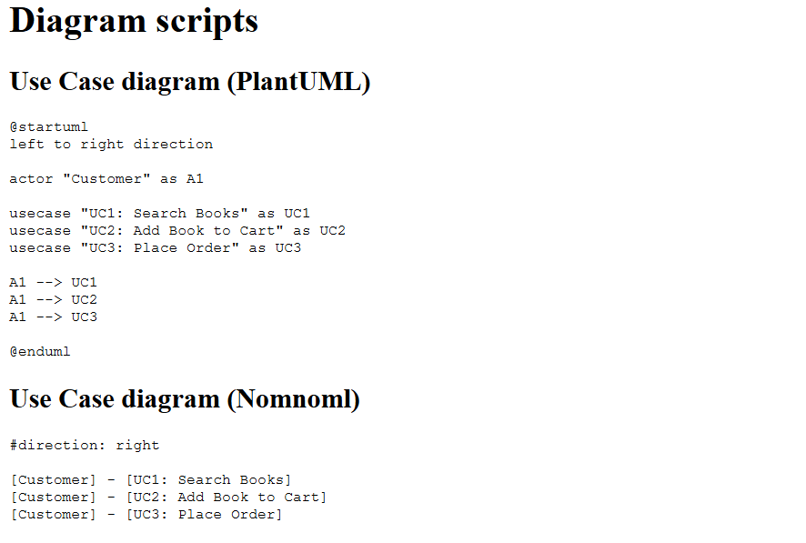

Additional application screenshots are available in the
[docs/screenshots](docs/screenshots) directory.

## Software Architecture

The application follows a layered MVC architecture, separating
application responsibilities into the following layers:

- **Controller Layer:** Handles incoming requests and user interactions.
- **Service Layer:** Implements the application business logic.
- **Repository Layer:** Manages database access and persistence.
- **Domain Model:** Represents application entities and their relationships.
- **View Layer:** Provides the user interface through Thymeleaf templates.

## UML Design Diagrams

The following diagrams were created during the original software
design and development process. They document the architecture
and domain model of the academic project before the
post-submission improvements.

### Use Case Diagram

Illustrates the system actors and the main functional
requirements of the application.

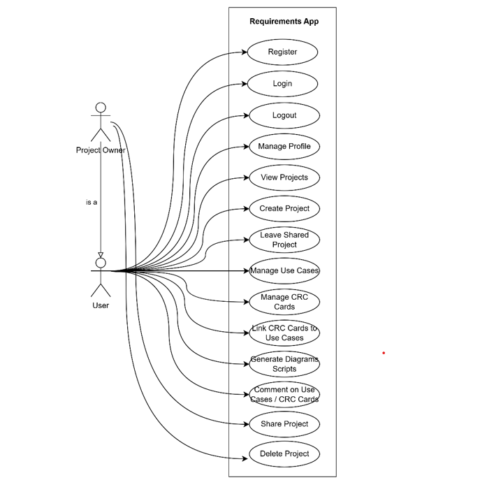

### Package Diagram

Illustrates the layered software architecture and the
dependencies between the application packages.

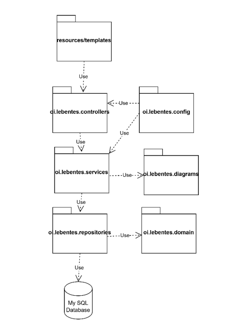

### Domain Model Class Diagram

Represents the main domain entities, their attributes
and relationships.

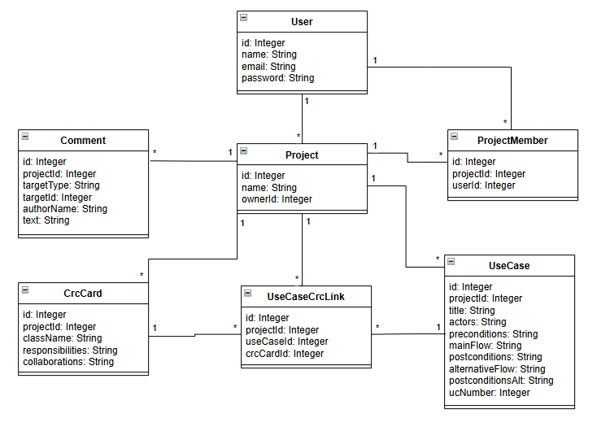

### Diagram Generation Class Diagram

Illustrates the implementation of the Strategy and
Parameterized Factory design patterns used for UML
script generation.

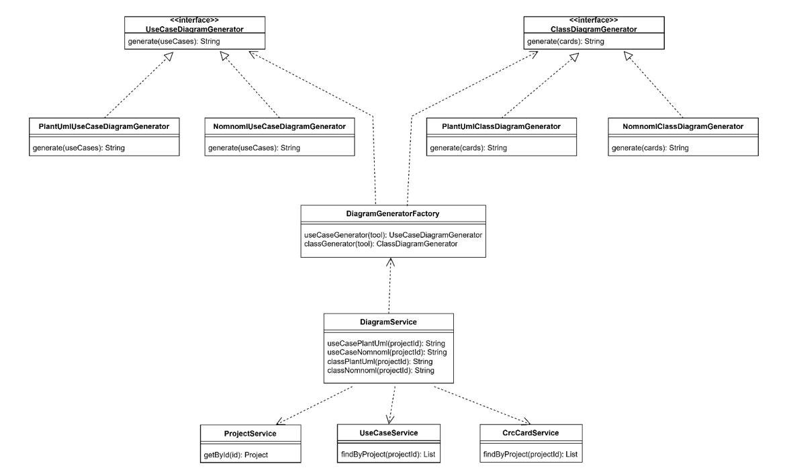

## Design Patterns

The application incorporates the following software design patterns:

- Strategy Pattern
- Parameterized Factory Pattern
- Template View Pattern

The Strategy and Parameterized Factory patterns are used in the
UML script generation functionality, supporting different
diagram generation implementations.

The Template View pattern is used to present application data
through server-side Thymeleaf templates.

## Generated UML Diagrams

The application generates UML scripts from the Use Cases
and CRC Cards defined by the users.

The following diagrams were rendered using the scripts
generated by the application for the Online Bookstore
System example.

### PlantUML Use Case Diagram

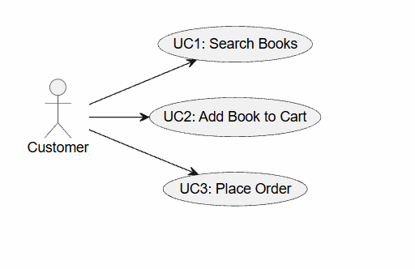

### PlantUML Class Diagram

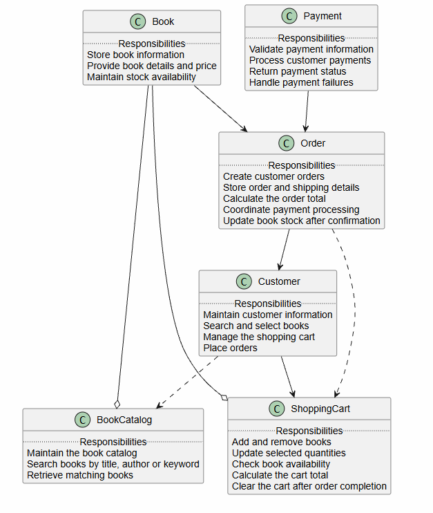

### Nomnoml Use Case Diagram

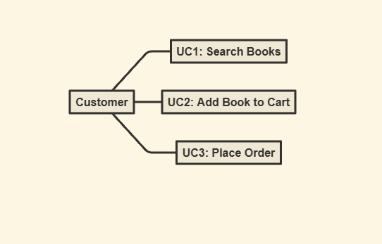

### Nomnoml Class Diagram

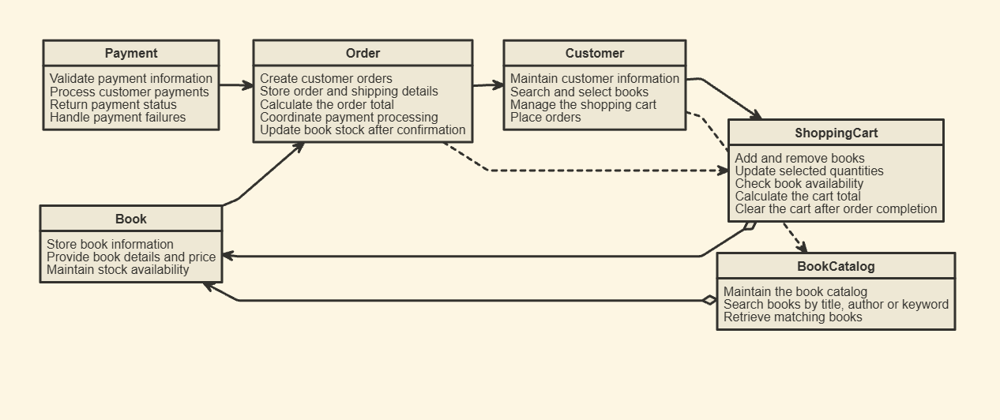

The generated scripts can be rendered using:

- [PlantUML](https://www.plantuml.com/)
- [Nomnoml](https://www.nomnoml.com/)

## Software Engineering Principles

- Object-Oriented Programming (OOP)
- Model-View-Controller (MVC)
- Separation of Concerns
- Dependency Injection
- Layered Architecture
- Requirements Analysis
- Software Modeling
- CRUD Operations
- Unit Testing
- Access Control

## Security

The application uses Spring Security for user authentication
and BCrypt for password hashing.

Database credentials are provided through environment variables
instead of being hardcoded in the application configuration.

Project collaboration uses project membership and access checks.

Comment ownership is determined using the unique ID of the
author. Users can edit or delete only their own comments,
with ownership verification performed at the service layer.

## Development Methodology

The application was developed by a team of three students
following the Scrum methodology, organized into six sprints.

The development process involved:

- Requirements analysis
- Software design and UML modeling
- Sprint planning
- Incremental implementation
- Testing and debugging
- Technical documentation

### Sprint Planning and Implementation

The original development process was organized into six
Scrum sprints over a period of twelve weeks, from
March to May 2026.

| Sprint | Period | Duration | User Stories | Implemented Functionality |
| --- | --- | --- | --- | --- |
| 1 | 01/03/2026 – 14/03/2026 | 2 weeks | US1–US3 | User registration, login, profile management and logout |
| 2 | 15/03/2026 – 28/03/2026 | 2 weeks | US4–US6 | Project creation, viewing and deletion |
| 3 | 29/03/2026 – 18/04/2026 | 3 weeks | US7–US10 | Use Case creation, editing, viewing and deletion |
| 4 | 19/04/2026 – 02/05/2026 | 2 weeks | US11–US14 | CRC Card management and linking with Use Cases |
| 5 | 03/05/2026 – 16/05/2026 | 2 weeks | US15–US16 | PlantUML and Nomnoml script generation |
| 6 | 17/05/2026 – 23/05/2026 | 1 week | US18–US19 | Project sharing and comments on Use Cases and CRC Cards |

### Definition of Done

A User Story was considered completed when its
corresponding functionality was implemented correctly
and validated through appropriate tests.

## Team Collaboration

The project was developed collaboratively by three students
through shared coding sessions, collective design decisions,
implementation, debugging and testing.

All three team members actively participated in the development
process, working together throughout the project lifecycle.

## Testing

The project includes automated unit tests using JUnit Jupiter
and Mockito, covering:

- User management
- Project management
- Use Case management
- CRC Card management
- UML script generation
- Project collaboration
- Comment management
- Comment ownership and access control

### Unit Test Results

All 119 unit tests in the `testsPackage` package were
successfully executed using the JUnit test runner in Eclipse IDE.

| Metric | Result |
| --- | ---: |
| Total tests | 119 |
| Passed | 119 |
| Errors | 0 |
| Failures | 0 |
| Success rate | 100% |

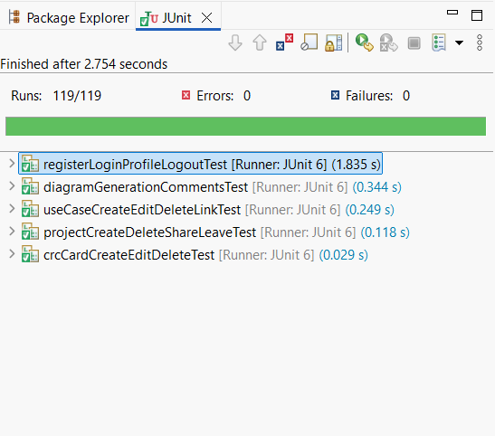

The generated PlantUML and Nomnoml scripts were also
manually validated by rendering all four corresponding
diagrams.

### Running the Tests

To execute the project's Maven test phase on Windows, run:

```powershell
.\mvnw.cmd test
```

## Post-Submission Improvements

Following the original academic submission, the application
was further improved in preparation for portfolio presentation.

The improvements include:

- Extended database text fields for Use Case descriptions
- Improved presentation of Use Cases and CRC Cards
- Improved presentation of project information
- Comment editing and deletion functionality
- Comment ownership verification
- Updated unit tests
- Improved database credential configuration
- Additional application documentation and screenshots

## Getting Started

### Prerequisites

- Java 17 or later
- MySQL

The project includes the Maven Wrapper, so a separate Maven
installation is not required.

### Database Setup

Execute the following SQL commands in MySQL:

```sql
CREATE DATABASE IF NOT EXISTS requirements_app;

CREATE USER IF NOT EXISTS 'req_user'@'localhost'
IDENTIFIED BY 'YOUR_PASSWORD';

GRANT ALL PRIVILEGES ON requirements_app.*
TO 'req_user'@'localhost';
```

Replace `YOUR_PASSWORD` with your own database password.

If the database user already exists, use its existing password.

The required database tables are created automatically
by Hibernate when the application starts with a new database.

### Environment Variables

Open PowerShell in the root directory of the project and set
the database credentials:

```powershell
$env:DB_USERNAME="req_user"
$env:DB_PASSWORD="YOUR_PASSWORD"
```

### Run the Application

In the same PowerShell window, run the application using
the Maven Wrapper:

```powershell
.\mvnw.cmd spring-boot:run
```

Once the application starts, open your browser and navigate to:

http://localhost:8080

Register a new user to start using the application.

## Documentation

The project documentation is organized into the following
directories:

```text
docs/
├── diagrams/
├── generated-diagrams/
└── screenshots/
```

- [Design Diagrams](docs/diagrams)
- [Generated UML Diagrams](docs/generated-diagrams)
- [Application Screenshots](docs/screenshots)

## Academic Information

- **University:** University of Ioannina
- **Department:** Computer Science and Engineering
- **Course:** Software Engineering
- **Academic Year:** 2025-2026
- **Project Type:** Academic Team Project
- **Team Size:** 3 students
- **Development Methodology:** Scrum
- **Number of Sprints:** 6

## Copyright

Copyright © 2026 the project contributors.

All rights reserved.

This project was originally developed for academic purposes
and is publicly presented for educational and portfolio
purposes with the consent of all project contributors.

No open-source license is granted for the original project code.
